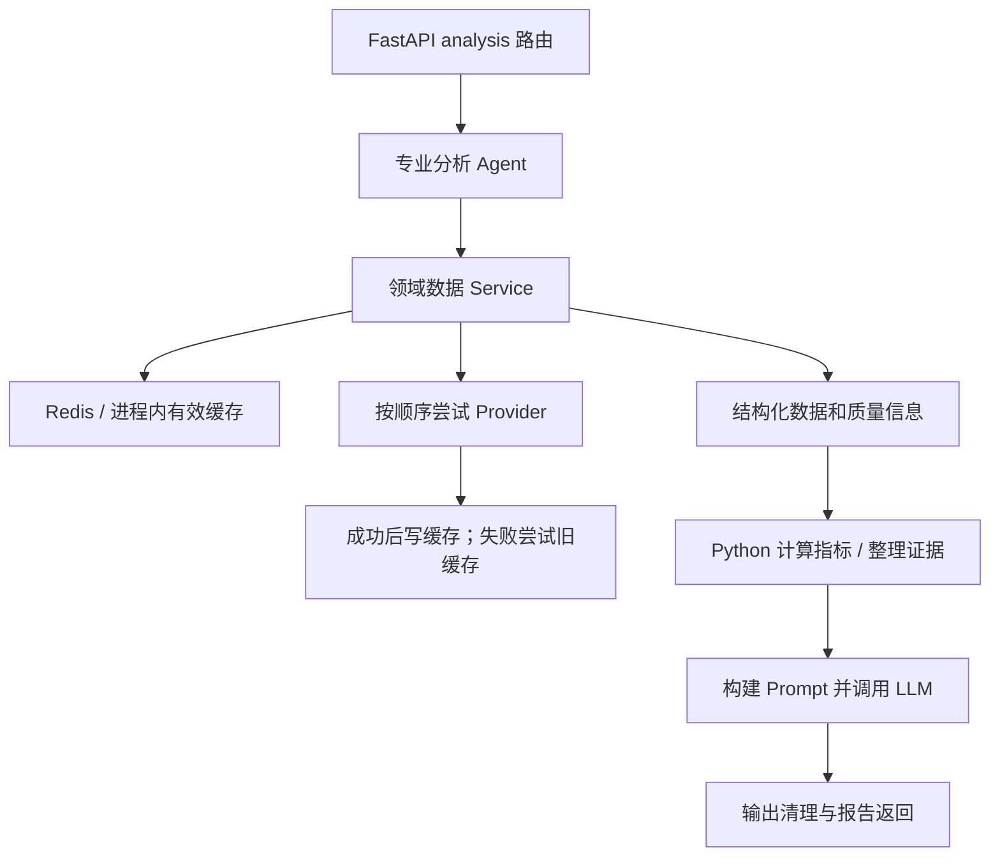

# 数据管道与 Agent 代码导读

本文基于当前工作区源码，重点说明股票分析主链路、Chat 分流以及技术指标计算。仓库保留多代实现，实际执行路径由路由和配置决定，不能仅凭文件名判断。

## 1. 股票分析的数据如何流动



- **HTTP 入口**：`backend/app/routers/analysis.py`。校验市场与代码、检查登录，取得 LLM 客户端后调用 Agent。单项同步分析通过 `asyncio.to_thread()` 执行，避免直接阻塞事件循环。
- **行情服务**：`backend/app/services/stock_data_service.py`。统一暴露 `get_quote()` / `get_kline()`；Provider 负责外部接口、证券代码格式和数据字段转换，Agent 无须知道某个供应商的响应格式。
- **返回契约**：报价用 `QuoteResult`，K 线用 `KlineResult`，包含数据、`provider`、`cached`、`stale`、`fallback_chain`、`http_status` 等。可以区分有效缓存、旧数据降级和完全不可用。

行情服务的实际尝试顺序：

| 数据 | CN | HK |
| --- | --- | --- |
| 报价 | Eastmoney → Sina → Tencent | Tencent → AkShare |
| K 线 | Eastmoney Kline → Tencent Kline → AkShare | Tencent Kline → AkShare |

缓存命中时不请求上游。所有上游失败时，若有旧缓存则返回旧数据并标注 `stale=true`；无可用历史数据则返回 503 状态的结果。这里描述的是代码的回退顺序，未验证当前外部供应商在线情况。

`stock_cache_service.py` 的有效缓存顺序是 Redis → 进程内存；成功获取后写入两层。报价 TTL 为 60 秒，K 线 TTL 为 600 秒。旧数据备份只保存在进程内，重启后丢失，且没有自动失效上限。部分较早的架构文档仍称其为纯内存缓存，应以当前实现为准。

## 2. 其他数据域

- **基本面快照**：`fundamental_data_service.py` 把估值、盈利、成长和财务健康整理为结构化结果，主要通过 AkShare/基本面 Provider 获取 CN 数据，并按字段提供回退。字段缺失用 `None` 和 `missing_fields` 表示；HK 覆盖有限。此旧快照链路并不代表公司页所有财报数据的覆盖情况。
- **新闻**：`news_data_service.py` 获取新闻，按时间窗口筛选并缓存。Provider 失败时尝试历史缓存，否则返回带失败说明的空结果；`NewsAnalystAgent` 再整理和去重新闻证据。
- **公司页与 Chat 共享财务数据**：`company_chat_data_service.py` 调用公司历史 dashboard 等已有服务，整理指标候选、报告期、单位和可用性。它与旧的基本面快照链路并存；研究 Chat 不应仅因某个旧快照字段缺失就断言公司完全没有该数据。

## 3. 技术面 Agent：逐步看一次分析

入口是 `TechnicalAnalystAgent.analyze()`，位于 `backend/app/agents/technical_analyst.py`：

1. 调用 `get_kline_for_agent()`，默认取最近 120 根日 K 线、前复权。K 线是必需输入；无数据时抛 `RuntimeError`。
2. 调用 `get_quote_optional()`，报价失败返回 `None`；构建 Prompt 时改用最后一根 K 线收盘价，并标明来源。
3. 调用 `TechnicalIndicatorService.calculate(bars)`，由确定性的 Python 运算产生指标。
4. `_build_user_prompt()` 整理价格、日期范围、指标、成交量单位及数据限制。
5. 调用注入的 `BaseLLMClient.chat(messages, temperature=0.3)` 生成文字解释。
6. 调用 `sanitize_specialist_output()` 清理输出后返回 Markdown。`report_reader_mode` 控制 beginner / standard 提示词选择。

因此，均线和涨跌幅由 Python 计算；LLM 负责基于这些输入解释走势。系统提示词约束缺失数据、分析范围和估算成交额的用途，输出清理提供额外约束，但不等于对每句自然语言完成了事实验证。

其余专业 Agent 采用类似边界：

| Agent | 主要职责 |
| --- | --- |
| `FundamentalAnalystAgent` | 解释基本面快照，披露报告期和缺失字段 |
| `PeerComparisonAnalystAgent` | 发现同行并对比；异步入口支持动态同行发现 |
| `NewsAnalystAgent` | 基于新闻与公告证据整理事件、影响和限制 |

## 4. 综合报告与实时进度

`ComprehensiveAnalysisCoordinator` 同时持有技术面、基本面、同行和新闻四个 Agent：

- 异步综合入口通过 `asyncio.gather(..., return_exceptions=True)` 并发执行四项分析；同步 Agent 通过线程运行，同行使用异步方法。
- 单个 Agent 的等待超时为 300 秒；失败或超时记录到该模块的状态，保留其他模块结果。`wait_for()` 超时并不保证线程中的同步网络调用立即终止。
- 收集到报告后再调用 LLM 综合；综合生成失败有回退报告，全部模块不可用时生成数据不足报告，并返回模块状态、警告和 `partial` 信息。
- `analyze_scoped()` 支持按分析范围选择模块。

另一个实现是 `langgraph_analysis_graph.py`：身份识别 → 范围准备 → 所需专业 Agent → 汇总 → 综合或单项报告 → 最终处理。它是已经实现的可选引擎。配置字段 `default_analysis_engine` 的代码默认值是 `custom_coordinator`，也可以显式选择 `langgraph`。

`POST /analysis/runs` 创建后台运行，`GET /analysis/runs/{id}/events` 通过 SSE 传送进度；`RealtimeAnalysisRunner` 和 `LangGraphRealtimeRunner` 分别提供对应的实时执行路径。界面显示进度不会改变指标计算公式。

## 5. Chat Agent 的入口与分流

`backend/app/routers/chat.py` 接收消息，交给 `app/agents/chat_orchestrator.py` 的 `process_message()`。它负责上下文、实体识别、意图分类、能力选择和事件输出；并非每条消息都会进入同一个 Agent。

- `chat_runtime_mode` 的代码默认值为 `legacy`。此路径中，规则规划器、技能注册表、工具注册表以及金融 Agent 等按问题和能力开关分流执行。
- 设为 `layered_v1` 时，尝试 `financial_runtime/runtime.py`：意图与安全路由 → 上下文 → 执行计划 → 工具调用 → 领域 Agent → 结构化回答。未迁移的能力或运行异常可以回退到 legacy。
- 设为 `shadow` 时，新 runtime 后台运行用于对照，当前回答仍沿原路径生成。
- 启用独立的多 Agent 编排开关后，符合条件的复杂金融问题可进入 `orchestrator/financial_orchestrator.py`：基本面/行情/按需新闻 → 证据汇总 → 风险审核 → 综合回答。

以上是源码分支及默认值；部署环境配置可能选择不同路径。`CentralPlanningAgent` 在这里生成计划与进度事件，不能把一条计划事件当成工具已经成功执行的证据。

## 6. 指标计算口径

实现在 `backend/app/services/technical_indicator_service.py`，本身不导入数据库、行情 Provider、LLM、pandas 或 numpy。

| 输出 | 公式 / 行为 |
| --- | --- |
| `ma5/10/20/60` | 最近 N 个有效收盘价的算术均值；不足 N 个返回 `None` |
| `return_Nd_pct` | `(最新收盘价 / N 根之前的收盘价 - 1) × 100`，需要 N+1 个收盘价；基数为零返回 `None` |
| `price_vs_maN_pct` | `(最新收盘价 / MAN - 1) × 100` |
| `high/low_20d/60d` | 最近 N 个有效 high/low 的极值；不足 N 个时使用已有数据 |
| `volume_avg_5d/20d` | 最近 5/20 个有效成交量的均值，包含最新一根 |
| `volume_ratio_5_20` | 5 根均量 / 20 根均量；分母为零返回 `None` |
| `volume_ratio_today` | 最新成交量 / 5 根均量；不是与前五根均量比较 |
| 短期 / 中期趋势 | 比较 MA5 与 MA10 / MA10 与 MA20；差值超过 +0.3% 为上升，低于 -0.3% 为下降，其余横盘 |
| 量能信号 | 有 5/20 量比时，今日量比 >1.5 优先判定单日明显放量；否则 5/20 量比 >1.2 为近期放量、<0.8 为近期缩量，其余平稳 |

结果通常保留两位小数；相对均线位置和量比会使用已经舍入的均值。这里没有实现 RSI、MACD。

使用时需要理解三个边界：

1. 输入须按日期升序；服务不自行排序。`d` 实际按 K 线条数计数，不按自然日计数。
2. 无效字段分别过滤，因此中间缺失字段会压缩各自序列，窗口不一定对应相同日期；`latest_date` 仍取原始最后一条。当前转换屏蔽 NaN，但未过滤正负无穷。调用方仍需保证完整、有限且对齐的数据。
3. Agent 专用数据接口只返回 bars / quote 数据，未携带完整 `stale`、`provider` 和回退链元信息。路由能获取这些信息，不代表报告生成器也已完整利用它们。

## 7. 本次新增测试

`backend/tests/test_technical_indicator_service.py` 直接调用公开的 `calculate()`，不需要网络、API Key、数据库或 LLM。11 个测试函数通过参数化覆盖 30 个用例，包括手算结果、窗口边界、正负收益、极值范围、量能优先级、趋势阈值、零分母、可选字段缺失、空数据及 JSON 输出。

在项目根目录运行：

```sh
backend/.venv/bin/python -m pytest -q backend/tests/test_technical_indicator_service.py
```

同时运行已有专业 Agent 回归：

```sh
backend/.venv/bin/python -m pytest -q backend/tests/test_technical_indicator_service.py backend/tests/fundamental/test_phase6u_specialist_analysis.py
```

本次验证结果：58 passed（新增 30 项 + 既有 28 项），有一条来自 passlib 的 `crypt` 弃用警告。验证范围是本地指标单元测试和该组专业 Agent 回归，未验证外部行情可用性或整站端到端流程。
